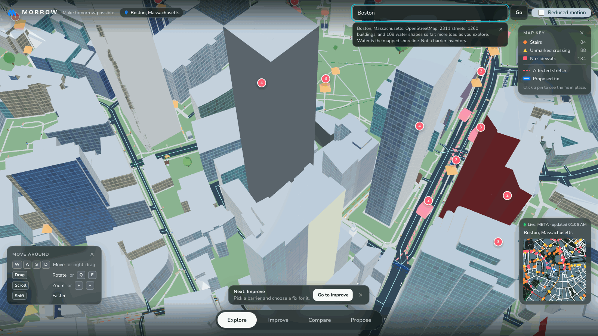
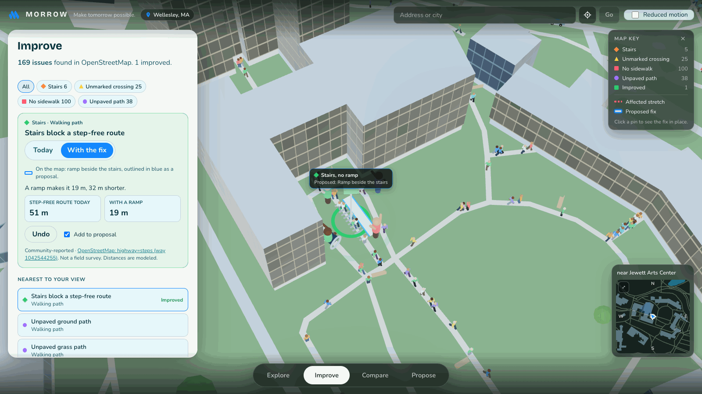
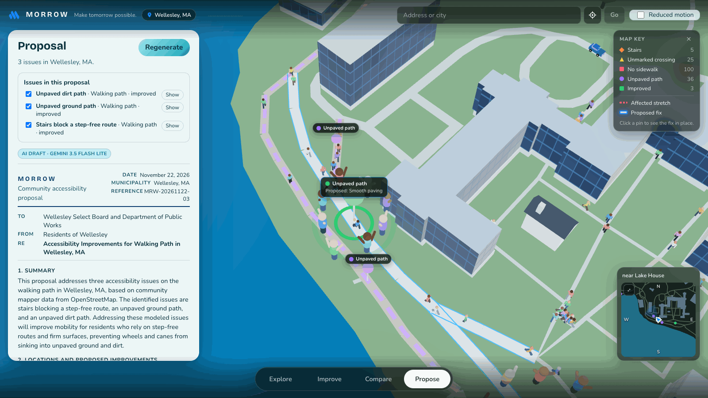
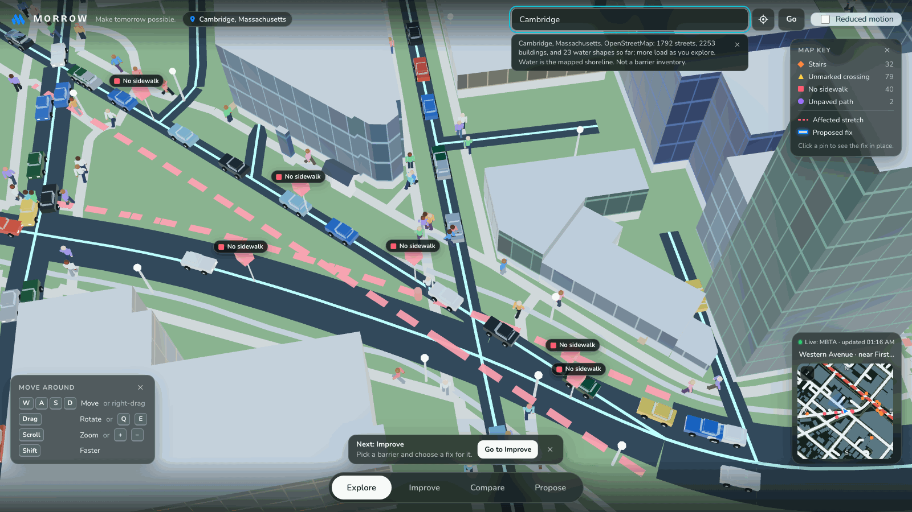
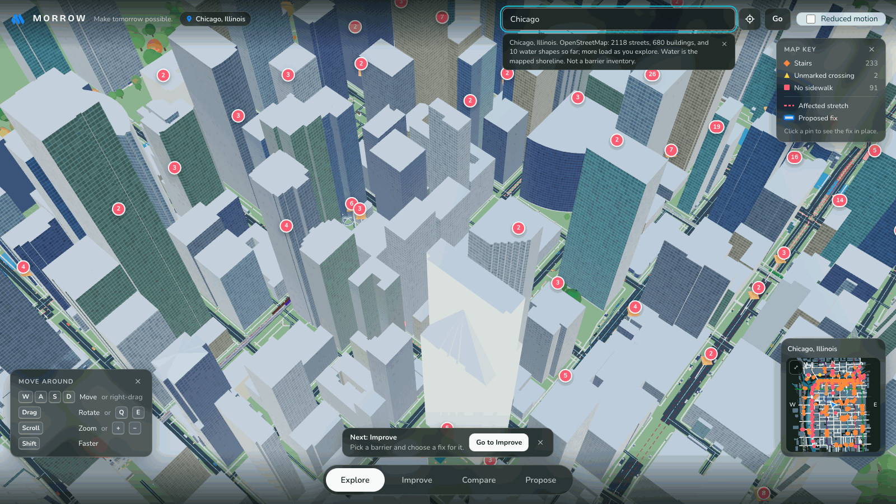
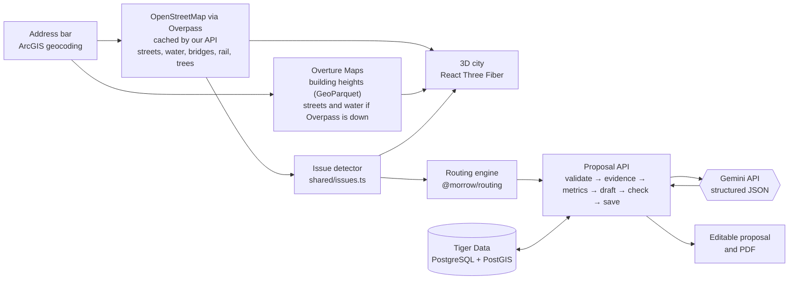

<!-- markdownlint-disable-next-line MD041 -->
<p align="center">
  
</p>

<h1 align="center">MORROW</h1>

<p align="center">
  <strong>Ashsmith Khayrul</strong> · <strong>Caroline Hu</strong> · <strong>Alexander Duan</strong> · <strong>Sophia Zheng</strong><br />
  WHACK 2026 · Better Worlds: Dreaming of a Better Future
</p>

<p align="center">
  <strong>Make tomorrow possible.</strong> Type any US city and MORROW rebuilds it in 3D from open map data, finds the stairs with no ramp, the missing sidewalks and the unmarked crossings, lets you try a fix in place, measures what it changes, and drafts a proposal a resident can take to town hall. The numbers come from our code; Gemini only writes the letter.
</p>

<p align="center">
  <a href="https://plsfixthisshit.work">
    
  </a>
  
</p>

<p align="center">
  
  
  
  
</p>

<p align="center">
  
  
  
  
</p>

<p align="center">
  <a href="#the-problem">The problem</a> ·
  <a href="#what-morrow-does">What it does</a> ·
  <a href="#how-it-works">How it works</a> ·
  <a href="#open-the-demo">Open the demo</a> ·
  <a href="#how-morrow-keeps-the-facts-honest">Honesty</a> ·
  <a href="#sponsors">Sponsors</a> ·
  <a href="#run-it-yourself">Run it yourself</a> ·
  <a href="#team">Team</a>
</p>

<p align="center">
  
</p>
<p align="center">
  <sub>Downtown Boston, rebuilt from open map data. Every pin is a barrier MORROW found in the map's own accessibility tags.</sub>
</p>

<table>
  <tr>
    <td width="50%"></td>
    <td width="50%"></td>
  </tr>
  <tr>
    <td><sub><strong>Improve.</strong> A staircase with no step-free route, and the ramp that would fix it, previewed in place.</sub></td>
    <td><sub><strong>Propose.</strong> An editable letter for town hall, drafted by Gemini from facts the server checked.</sub></td>
  </tr>
  <tr>
    <td width="50%"></td>
    <td width="50%"></td>
  </tr>
  <tr>
    <td><sub><strong>Street level.</strong> Central Square, Cambridge: traffic, pedestrians and the barriers along the way.</sub></td>
    <td><sub><strong>Any US city.</strong> The Chicago Loop, streamed in as you look around.</sub></td>
  </tr>
</table>

---

## The problem

Stairs with no ramp, sidewalks that just end, and unmarked crossings block wheelchair users, parents with strollers, older adults and people with low vision. The people affected usually find them on the street, the hard way. MORROW's detector finds **174** of them in Wellesley alone.

- **1 in 5** Americans will be 65 or older by 2030, and 2 in 5 people over 65 have a disability (U.S. Census Bureau, 2017 National Population Projections; CDC, 2018).
- Wheelchair users face a **36%** higher pedestrian death rate (Georgetown University, BMJ Open, 2015, U.S. crash data 2006–2012).

They rarely get fixed, for two reasons:

- **No measurable impact.** Officials prioritize by detour length, time saved and people affected. Residents rarely have those figures.
- **Formal proposals are a barrier of their own.** Town processes expect structured writing most residents don't have the time or know-how to produce.

The people with the strongest case are often the least heard.

## What MORROW does

**Explore → Improve → Compare → Propose**, in any US city.

1. **Find.** Type a city or address. MORROW rebuilds it in 3D from OpenStreetMap streets, water, coastline, beaches and mapped trees, with Overture Maps building footprints extruded to their measured heights. Houses look like houses, downtowns look like downtowns, and the rest of the city streams in as you look around, lit by a low golden-hour sun. It reads the map's own accessibility tags and flags real barriers: stairs with no step-free route, unmarked crossings, streets without sidewalks, unpaved paths.
2. **See.** Each kind of barrier has its own pin, the affected stretch of street is dashed on the map, and a map key explains the colors. Cars drive, people walk, bridges span the water, and transit lines run in their real colors, with live trains where agencies publish positions.
3. **Improve.** Pick a barrier and preview the fix where it would go: a ramp beside the stairs, a zebra crossing with curb ramps and tactile pads, a new sidewalk, or smooth paving. Switch between **Today** and **With the fix**.
4. **Compare.** See the modeled before and after for the route the fix affects (shorter detours, more people reached), computed by our routing engine, not by a model.
5. **Propose.** Generate an editable proposal letter for town hall. Gemini writes it from facts the server has already checked, and it exports as a town-hall-ready PDF.

## How it works



- **The city.** Streets, water, bridges, rail, beaches and trees come from OpenStreetMap through Overpass. Trees stand where mappers put them (`natural=tree` and `tree_row`), and random lawn trees fill in only where nothing is mapped. Building heights come from the Overture Maps 2026-11-18.0 release, read straight from GeoParquet with HTTP range requests. Every surface type is merged into one mesh, and trees, cars, people and street furniture are instanced, so thousands of buildings stay fast in a browser.
- **Loading.** The public Overpass servers are often busy or refuse requests, so browsers ask our API first. It answers from a disk cache kept for a week, or asks Overpass once per query, and it pre-loads about 60 places (major US cities, tourist spots, Boston-area and college towns) at startup. When Overpass can't answer at all, streets, paths, rail and water come from Overture Maps' static files instead, reading only the parts that overlap the tile. Without the API, browsers fall back to three public Overpass servers directly.
- **Look.** The default look is golden hour: a low warm sun, long soft shadows baked once per city build, and a warm-to-cool sky, with no extra draw calls. `?look=classic` shows the earlier look.
- **Streaming.** After the first tile, MORROW works out the ground the camera can see, out to the fog, and downloads it nearest first, one request at a time, rebuilding only while the camera is still.
- **Issues.** A shared detector reads OSM tags (stairs, crossings, sidewalks, surfaces) and returns each issue with its location, the affected stretch, a suggested fix, and before/after facts. The same code runs in the browser and on the server.
- **Transit.** Track is colored by line from OSM route relations in every city, and simulated trains run on it. Live positions replace them where they exist: the MBTA's V3 API directly in the browser, plus LIRR, Metro-North, SEPTA, Minneapolis Metro Transit and Denver RTD through a small GTFS-realtime proxy in our API.
- **Proposals.** A Node API runs one workflow per proposal: validate the request, load the evidence, compute the route metrics, draft with Gemini, validate the draft, and save it to Tiger Data.

## How MORROW keeps the facts honest

- **The model never does the math.** Locations, route lengths, before/after figures and evidence labels come from map data and the routing engine, and the proposal renders them from server data, not from Gemini's prose.
- **The server doesn't trust the browser.** The API accepts known ids and recomputes the facts itself before anything reaches Gemini.
- **Every issue carries its evidence status:** verified, community reported (OpenStreetMap mapper data, not a field survey), or illustrative. The Wellesley showcase barrier is illustrative, and route results are always labeled modeled.
- **Outages are labeled, not hidden.** If Gemini is unavailable, a deterministic template fills the same structure and says so. If Tiger Data is down, the bundled Wellesley dataset keeps the demo working, labeled as such. If a city's streets came from Overture instead of OpenStreetMap, the place note says so.

## Sponsors

### Google Gemini API

Gemini writes the proposal: a headline, a plain-language summary, the rationale, a review request for officials, meeting talking points, and limitations. It runs on the server with a strict JSON schema, and every draft is validated with Zod before anyone sees it. The server starts on **Gemini 3.8 Flash** with thinking set to low, so it answers inside its time limit. If that model is busy, it tries every other text model the key can see, newest first, inside a 48-second budget. When an OpenRouter key is set and Gemini hasn't answered after 8 seconds, the same Gemini models (3.8 Flash, then 3.6 Flash, then 3.5 Flash-Lite) start through OpenRouter alongside it, and the first valid draft wins. The template is used only if every model fails. The editor shows which model wrote the draft. Code: [`packages/api/src/draft/gemini.ts`](packages/api/src/draft/gemini.ts).

### Tiger Data

Tiger Cloud PostgreSQL with PostGIS stores geolocated barrier records and every saved proposal. The barrier list for an area is a live spatial query (`ST_Intersects` against the visible bounding box), and each generated proposal is saved with its evidence label and calculation snapshot and can be reopened by id. Code: [`packages/api/src/data/tiger.ts`](packages/api/src/data/tiger.ts).

### SpaceXSI

We built MORROW only with Cursor and Grok Bot.

### GoDaddy Registry

Our domain, registered through GoDaddy Registry: **[plsfixthisshit.work](https://plsfixthisshit.work)**.

## Open the demo

**Public URL:** [https://plsfixthisshit.work](https://plsfixthisshit.work). No login and no judge account. The web app is a static build on GitHub Pages behind that custom domain; the proposal API runs as a Docker image (`ghcr.io/lavishsphere/morrow:latest`) behind `https://api.morrow.khayrul.com`.

A 90-second path: type a city in the address bar, pick a pin, switch **Today / With the fix**, press **Improve**, open **Compare**, then **Propose** and export the PDF. The Wellesley showcase scenario is `wellesley-demo-01` with the intervention `wellesley-intervention-ramp-01`.

## Run it yourself

```bash
npm install
npm run dev          # web app on http://localhost:5173
npm run api:dev      # optional: proposal API on http://127.0.0.1:8787
npm run ci           # Markdown and TypeScript lint, typecheck, tests, build, audit
```

During `npm run dev`, Vite proxies `/api` to the hosted API. Set `VITE_API_PROXY=http://127.0.0.1:8787` to use a local one.

<details>
<summary><strong>API environment variables</strong></summary>

| Variable | Required | Notes |
| --- | --- | --- |
| `GEMINI_API_KEY` | No | Server only. When unset, proposals use the deterministic template. |
| `GEMINI_MODEL` | No | Gemini 3.8 Flash is always tried first; this adds a second choice. |
| `DATABASE_URL` | No | Tiger Data / PostGIS with TLS (`sslmode=require`). Unset → bundled dataset. |
| `PORT` / `HOST` | No | Defaults `8787` / `127.0.0.1`. |
| `OPENROUTER_API_KEY` | No | Server only. Turns on the OpenRouter fallback for Gemini models. |
| `OPENROUTER_MODELS` | No | Comma-separated override; default Gemini 3.8 Flash, 3.6 Flash, 3.5 Flash-Lite. |
| `MORROW_CORS_ORIGIN` | No | Exact origin or a comma-separated list; omit for `*`. |
| `MORROW_CACHE_DIR` | No | OpenStreetMap cache folder. Defaults to `/home/container/osm-cache` on Pterodactyl, else `.osm-cache`. |
| `MORROW_PREWARM` | No | Set to `0` to skip pre-loading cities at startup. |
| `WMATA_API_KEY`, `CTA_TRAIN_TRACKER_KEY`, `METRA_API_TOKEN`, `TRIMET_APP_ID`, `SF511_API_KEY` | No | Turn on live trains for those agencies. |
| `VITE_API_BASE` | No | Front-end API base (no trailing slash). Required for GitHub Pages → hosted API. |

Never put `GEMINI_API_KEY` or `DATABASE_URL` in `VITE_*` variables. Template: [`.env.example`](.env.example). API details: [`packages/api/README.md`](packages/api/README.md).

</details>

<details>
<summary><strong>What the fallbacks do</strong></summary>

| If this is down | What you still get |
| --- | --- |
| Gemini | The same Gemini models through OpenRouter (if a key is set), then the template proposal, labeled as a template. |
| Tiger Data | The bundled Wellesley dataset, labeled unavailable for saving. |
| The hosted API | The static app; proposals are built in the browser from the same facts. |
| Overpass, for a cached place | The city from the API's disk cache. |
| Overpass, for an uncached place | Streets, paths, rail and water from Overture Maps, with Overture buildings. No trees or beaches, and fewer issue types, because Overture lacks the finer accessibility tags. |
| The hosted API's map cache | Browsers ask the public Overpass servers directly, with failover across three of them. |
| Live transit feeds | Simulated trains on the mapped track. |

Routing never falls back to made-up numbers: Compare always runs `compareScenario` on real graph data, and results are labeled modeled.

The pre-load covers major cities first, so a small town may still wait on Overpass, or load from Overture with fewer issues, the first time anyone opens it.

</details>

<details>
<summary><strong>CI and deploy</strong></summary>

| Workflow | When it runs | What it does |
| --- | --- | --- |
| [CI](.github/workflows/ci.yml) | Pull requests and pushes to `main` | App gates, workflow lint, secret scan, offline link check, npm audit |
| [Deploy](.github/workflows/deploy.yml) | Pushes to `main` | Re-runs the gates and publishes `dist/` to GitHub Pages |
| [CodeQL](.github/workflows/codeql.yml) | Pull requests, pushes to `main`, Mondays | `security-extended` analysis |
| [API image](.github/workflows/api-image.yml) | API changes land on `main` | Builds the API image and pushes it to GHCR |
| [External links](.github/workflows/links.yml) | Mondays | Live check of links in the README, docs and site |

The API host imports [`pterodactyl/morrow-api.json`](pterodactyl/morrow-api.json). Model and database credentials live only in the host's variables.

</details>

## Repository layout

```text
src/                   web app: React, React Three Fiber, the 3D city, modes and panels
  data/                Overpass, Overture, tile streaming, live transit, API client
  showcase/scene/      the city: buildings, streets, water, bridges, rail, traffic, issues
packages/api/          proposal API: workflow, Gemini drafting, Tiger Data, transit proxy, map cache
packages/routing/      @morrow/routing, the before/after route engine
shared/                issue detection and types used by both the app and the API
data/wellesley/        offline showcase bundle: basemap, water, demo dataset, attribution
docs/                  project plan, team plan, deploy notes
```

## Team

| | Role |
| --- | --- |
| **Ashsmith Khayrul** | Live data, API, infrastructure, domain |
| **Caroline Hu** | Accessible interface |
| **Alexander Duan** | 3D showcase, logo and branding |
| **Sophia Zheng** | Routing and reliability |

Built at WHACK 2026, Wellesley College, November 2026.

## Attribution and license

Map data © [OpenStreetMap](https://www.openstreetmap.org/copyright) contributors (ODbL). Building heights, and streets and water when Overpass is down, from [Overture Maps](https://overturemaps.org) release 2026-11-18.0. Showcase data credits and honesty rules: [`data/wellesley/ATTRIBUTION.md`](data/wellesley/ATTRIBUTION.md). Code is MIT ([`LICENSE`](LICENSE)).

<p align="center">
  <a href="https://plsfixthisshit.work"><strong>plsfixthisshit.work</strong></a>
</p>
